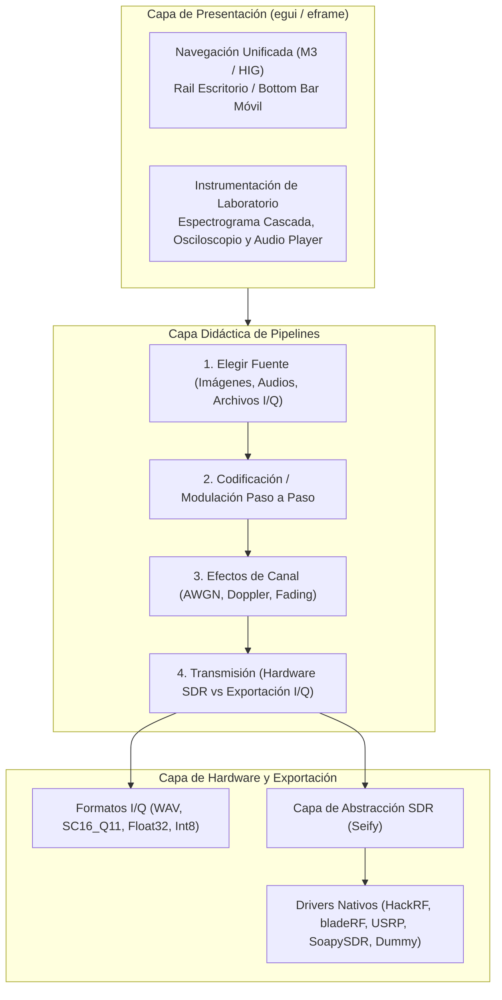
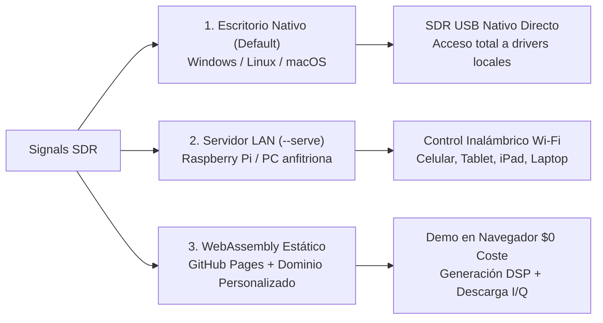

# Arquitectura del Sistema y Modalidades de Despliegue

Este documento describe la arquitectura modular de **Signals SDR**, el flujo de datos de procesamiento digital de señales (DSP) y las tres modalidades de ejecución contempladas en el proyecto (Escritorio Nativo, Servidor LAN y WebAssembly Estático).

---

## 1. Visión General de la Arquitectura

Signals SDR está construido en **Rust** utilizando un enfoque desacoplado en capas:



### Componentes Clave:
1. **Pipelines de Señal Didácticos (`src/pipelines/`):**
   - Cada transmisor satelital o analógico implementa un ciclo didáctico transparente:
     - **NOAA APT (`apt.rs`):** Escala de grises $\to$ Trama APT (2080 px/línea con marcas de sincro y telemetría) $\to$ Subportadora AM 2400 Hz $\to$ Modulación FM I/Q (17 kHz desv.).
     - **METEOR LRPT (`lrpt.rs`):** Compresión JPEG DCT $\to$ Empaquetado CCSDS Space Packet / VCDU $\to$ Reed-Solomon (255,223) $\to$ Scrambler $\to$ Convolucional FEC ($r=1/2, K=7$) $\to$ OQPSK 72 ksps.
     - **ISS SSTV y Generic SSTV (`iss_sstv.rs`, `generic_sstv.rs`):** Modos Robot 36/72, Martin 1/2, Scottie 1/2/DX, PD 120/180/290, BW 8/12 con síntesis analógica de tonos VIS.
     - **Generic FM (`generic_fm.rs`):** Broadcast WFM, NFM, pre-énfasis analógico de 50 µs / 75 µs y traslación IF.
     - **Generic AM (`generic_am.rs`):** DSB-FC con índice regulable, DSB-SC y SSB (USB/LSB) mediante transformada analítica de Hilbert.
     - **Generic I/Q (`generic_iq.rs`):** Gestor de archivos pregrabados con rotación de portadora, cancelación de DC y re-transmisión.
     - **NOAA HRPT didáctico (`hrpt.rs`):** Modulador digital BPSK Manchester Split-Phase-L a 665.4 kbps en banda L.

2. **Capa de Canal y Degradaciones (`src/channel/effects.rs`):**
   - Introduce imperfecciones reales del canal de RF:
     - **AWGN (Ruido Blanco Gaussiano):** Control de SNR desde -10 dB hasta +40 dB.
     - **Efecto Doppler Satelital:** Simulación de paso orbital con desplazamiento de frecuencia temporal ($\pm 3\text{ kHz}$).
     - **Atenuación y Desvanecimiento:** Fading Rayleigh/Rician emulando multitrayecto terrestre.

3. **Instrumentación de Visualización (`src/ui/spectrogram.rs` y `src/ui/audio_player.rs`):**
   - FFT de alta resolución, cascada espectral con gradientes de color dinámicos, osciloscopio interactivo con zoom temporal y reproductor de audio integrado para escuchar las señales antes de emitirlas.

---

## 2. Modalidades de Ejecución y Release

Signals SDR está concebido para operar bajo **tres modalidades complementarias**, garantizando que el usuario elija la mejor opción según su entorno y disponibilidad de hardware:



---

### Modalidad 1: Escritorio Nativo (Predeterminada)
- **Invocación:** `signals-sdr` o `cargo run --release`.
- **Destinatarios:** Estudiantes, investigadores y radioaficionados que ejecutan la suite directamente en su estación de trabajo (Windows, Linux, macOS).
- **Ventajas:** Máximo rendimiento DSP multinúcleo con aceleración nativa, soporte de todos los drivers SDR USB (HackRF, bladeRF, USRP, SoapySDR) con latencia mínima y organización de carpetas en el sistema de archivos local.

---

### Modalidad 2: Ejecutable en Modo Servidor Web LAN (`--serve`)
- **Invocación:** `signals-sdr --serve [puerto] [host]` (ejemplo: `signals-sdr --serve --port 8080 --bind 0.0.0.0`).
- **Destinatarios:** Laboratorios docentes y estaciones de radioaficionados donde los transceptores SDR están físicamente conectados a una computadora fija o a una Raspberry Pi conectada a las antenas o cargas ficticias.
- **Funcionamiento:**
  - El proceso de Rust inicia un servicio HTTP ligero con WebSockets.
  - El usuario abre la dirección en su navegador desde **cualquier dispositivo móvil o portátil conectado a la misma red Wi-Fi** (teléfono Android, iPhone, iPad, laptop):
    `http://192.168.1.100:8080`
  - **Ventaja Fundamental:** Ofrece **acceso nativo total a todos los dispositivos SDR por USB/Ethernet** (porque los drivers corren en el sistema operativo del anfitrión), permitiendo que el celular o la tablet actúen como un panel de control táctil inalámbrico sin cables USB colgando del teléfono.

---

### Modalidad 3: WebAssembly 100% Estático (GitHub Pages / Dominio Personalizado)
- **Despliegue:** Alojamiento estático gratuito en GitHub Pages (o Cloudflare Pages / Vercel) asociado al dominio del proyecto mediante registro DNS `CNAME`.
- **Destinatarios:** Usuarios de todo el mundo que desean probar la suite de inmediato desde su navegador web sin instalar Rust ni dependencias locales.
- **Capacidades en el Navegador:**
  - Toda la interfaz Material 3 / HIG funciona de manera idéntica a 60 FPS sobre WebGL/WebGPU Canvas.
  - La codificación completa (NOAA APT, LRPT, SSTV, FM, AM) y el filtrado DSP se calculan en la CPU/GPU del cliente mediante WebAssembly.
  - Inspección en vivo mediante el espectrograma, la cascada y el reproductor de audio web.
  - **Descarga directa:** Los usuarios pueden descargar los archivos generados en formato `.wav` (audio o I/Q) o `.raw` para luego utilizarlos en sus propios receptores o transmisores locales.

#### Limitaciones de la Versión Web Estática (Información al Usuario)
> [!NOTE]
> En la versión WebAssembly estática que corre en el navegador, aplican restricciones inherentes a la seguridad del sandbox web:
> 1. **Acceso a Hardware SDR:** Los navegadores web no tienen permiso para invocar drivers nativos de C/C++ ni abrir sockets de bajo nivel. Por tanto, la transmisión directa por hardware mediante bladeRF o USRP no está disponible en la versión web estática.
> 2. **Soporte WebUSB (Futuro):** La transmisión directa desde el navegador solo es técnicamente viable con dispositivos compatibles con la API **WebUSB** (como HackRF) en navegadores basados en Chromium (Chrome, Edge, Android). No es soportada por Safari ni Firefox.
> 3. **Sistema de Archivos:** No existe acceso al explorador de carpetas nativo del sistema operativo; las operaciones de entrada/salida se realizan mediante diálogo de carga y descarga de archivos del navegador web.
>
> La aplicación web incluye callouts informativos de Material 3 indicando estas diferencias para que el usuario conozca de antemano el alcance de la versión estática frente al ejecutable nativo.

---

### 2.4 Matriz Comparativa de Capacidades

| Característica | Modalidad 1: Escritorio (`signals-sdr.exe`) | Modalidad 2: Servidor LAN (`--serve`) | Modalidad 3: Web Estática (WASM / Pages) |
| :--- | :--- | :--- | :--- |
| **Entorno de Ejecución** | Windows / Linux / macOS (Nativo) | Host PC / Raspberry Pi (Servidor HTTP local) | Navegador Web (Chrome, Firefox, Safari) |
| **Hardware SDR USB** | Acceso USB nativo completo (Seify / Soapy) | Acceso USB en máquina host (Seify / Soapy) | Modo de simulación didáctica + aviso de Sandbox M3 |
| **Salida de Audio** | Motor de audio nativo de baja latencia (`rodio`) | Reproducción en dispositivo anfitrión | Web Audio API del navegador |
| **Gestión de Archivos** | Diálogos de archivo de SO directos (`rfd`) | Sistema de archivos del servidor anfitrión | Carga y descarga de archivos asíncrona del navegador |
| **Caso de Uso Ideal** | Transmisión principal en PC de laboratorio | Control táctil inalámbrico desde móvil o tablet en Wi-Fi | Demostración interactiva en línea sin instalación |

---

## 3. Guía de Comandos para Compilación y Despliegue

### Compilación y Ejecución de Escritorio
```bash
# Compilar binario optimizado para producción
cargo build --release

# Ejecutar aplicación de escritorio nativa
cargo run --release

# Compilar con soporte para hardware SDR específico
cargo run --release --features hackrf
cargo run --release --features bladerf
cargo run --release --features usrp
```

### Ejecución en Modo Servidor Web LAN
```bash
# Iniciar servidor LAN en puerto por defecto (8080)
cargo run --release -- --serve

# Opciones avanzadas de red
cargo run --release -- --serve --port 8080 --bind 0.0.0.0 --open
```

### Compilación y Prueba WebAssembly Estática
```bash
# Compilar release para producción (carpeta dist/)
trunk build --release --no-default-features

# Servidor de desarrollo con auto-recarga
trunk serve --no-default-features
```

### Comandos de Calidad y Pruebas
```bash
# Comprobación rápida de errores de sintaxis y tipos
cargo check

# Ejecutar suite de pruebas unitarias y de integración
cargo test

# Linter de código y buenas prácticas
cargo clippy

# Formateo de código según estándares de Rust
cargo fmt
```
