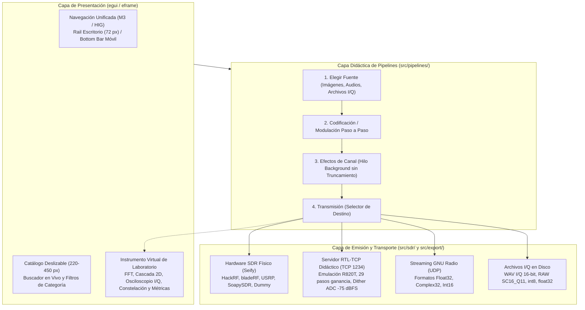
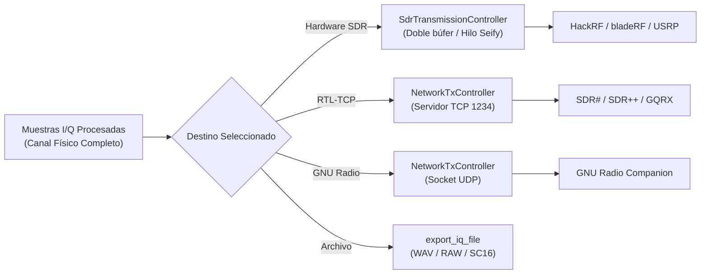
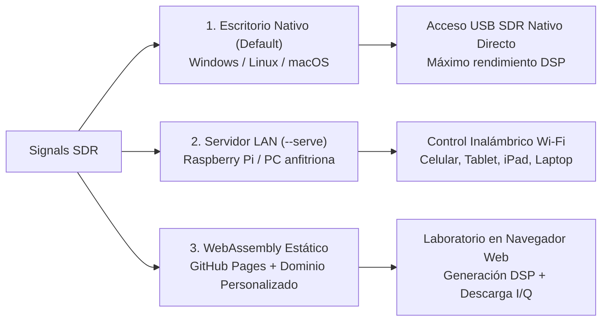

# Arquitectura del Sistema y Modalidades de Despliegue

Este documento describe la arquitectura modular de **Signals SDR**, el flujo de datos de procesamiento digital de señales (DSP), los subsistemas de transmisión por hardware/red y las tres modalidades de ejecución contempladas en el proyecto (Escritorio Nativo, Servidor LAN y WebAssembly Estático).

---

## 1. Visión General de la Arquitectura

Signals SDR está construido en **Rust** utilizando un enfoque modular desacoplado en capas:

---

## 2. Descripción de Componentes Clave

### 2.1. Pipelines Didácticos de Señal (`src/pipelines/`)
Cada transmisor implementa un ciclo pedagógico transparente e interactivo:

1. **NOAA APT (`apt.rs`):** Escala de grises $\to$ Trama analógica APT (2080 px/línea con sincro A/B, marcas de minuto y telemetría) $\to$ Subportadora AM a 2400 Hz $\to$ Modulación FM I/Q (17 kHz de desviación).
2. **METEOR LRPT (`lrpt.rs`):** Compresión JPEG DCT $8\times 8$ $\to$ Empaquetado CCSDS (Space Packet y VCDU) $\to$ Reed-Solomon (255,223) $\to$ Scrambler CCSDS $\to$ Convolucional FEC ($k=7, r=1/2$) $\to$ Modulación digital OQPSK a 72 ksps.
3. **ISS SSTV (`iss_sstv.rs`):** Modos oficiales conmemorativos de la Estación Espacial Internacional (Robot 36, PD 120, Martin 1) modulados en FM estrecha (5 kHz) a 288 kHz.
4. **Generic SSTV (`generic_sstv.rs`):** Soporte completo para 11 modos de radioaficionados: Martin 1/2, Scottie 1/2/DX, Robot 36/72, PD 120/180/290, Monocromo BW 8/12 con síntesis analógica de tonos VIS.
5. **Generic FM (`generic_fm.rs`):** Broadcast comercial WFM (75 kHz), comunicaciones VHF/UHF NFM (5 kHz), filtro de pre-énfasis analógico de 50 µs / 75 µs y traslación IF.
6. **Generic AM (`generic_am.rs`):** DSB-FC con índice $m$ regulable, DSB-SC y Banda Lateral Única (SSB USB / LSB) sintetizada mediante transformada analítica de Hilbert.
7. **Generic I/Q (`generic_iq.rs`):** Gestor de grabaciones I/Q pregrabadas con análisis FFT, corrección de offset DC, rotación Doppler de portadora y retransmisión.
8. **NOAA HRPT Didáctico (`hrpt.rs`):** Modulador digital BPSK y codificación Manchester Split-Phase-L a 665.4 kbps en banda L (1.7 GHz).

---

### 2.2. Simulación de Canal Físico en Segundo Plano (`src/channel/`)
La etapa de degradación física modela las perturbaciones del medio de propagación antes de la emisión:
- **AWGN:** Inyección de ruido térmico con control estricto de relación señal a ruido ($\text{SNR}_{\text{dB}}$) de $-10\text{ dB}$ a $+40\text{ dB}$, empleando la transformada de Box-Muller sobre el generador `FastRng`.
- **Efecto Doppler Satelital:** Simulación de paso orbital LEO mediante curva tangencial hiperbólica $f_{\text{doppler}}(t) = -f_{\text{max}} \tanh((t - t_0)/\tau)$ con desviación de hasta $\pm 3\text{ kHz}$.
- **Desvanecimiento Multitrayecto:** Fading Rician (con línea de vista directa LOS y factor $K_{\text{dB}}$) y Rayleigh (sin visión directa NLOS) con filtro de ensanchamiento Doppler (*Doppler spread*).
- **Procesamiento Asíncrono no Destructivo:** En Desktop nativo, la función `dispatch_compute_channel_iq` delega el cálculo a un hilo secundario del sistema operativo (`std::thread::spawn`). **No existe recorte de muestras (`limit`)**, garantizando que el 100% de la señal generada (ej. 17.5M+ muestras) se conserve íntegra para su posterior transmisión.

---

### 2.3. Subsistema de Hardware SDR y Transmisión por Red (`src/sdr/`)

#### Servidor RTL-TCP Didáctico
- **Protocolo de Enlace:** Escucha en `0x00.0x00.0x00.0x00:1234`. Al conectarse un cliente SDR (SDR#, SDR++, GQRX, etc.), envía un encabezado de 12 bytes:
  - `b"RTL0"` (4 bytes mágicos).
  - Tipo de sintonizador `5` (uint32_be): Rafael Micro R820T.
  - Cantidad de pasos de ganancia `29` (uint32_be).
- **Framing Acumulativo de Comandos:** Buffer de lectura acumulativa que procesa tramas de 5 bytes (1 byte código de comando + 4 bytes parámetro big-endian):
  - `0x01` (`SET_FREQUENCY`): Actualiza la frecuencia portadora sintonizada.
  - `0x02` (`SET_SAMPLE_RATE`): Actualiza la tasa de muestreo y sincroniza dinámicamente el reloj de *pacing* de los paquetes.
  - `0x03` (`SET_GAIN_MODE`): Conmuta entre ganancia automática (Tuner AGC) y control manual.
  - `0x04` (`SET_GAIN`): Configura la ganancia directa en décimas de dB (0 a 496).
  - `0x0D` (`SET_TUNER_GAIN_BY_INDEX`): Selecciona uno de los 29 escalones oficiales de ganancia del chip R820T (0.0 dB a 49.6 dB).
- **Modelo Físico de Atenuación y Dither:**
  - Atenuación logarítmica real en decibelios ($10^{(\text{gain}-38)/20}$), con saturación progresiva por encima del punto óptimo de 38 dB.
  - Dither continuo del ADC RTL2832U de 8 bits ($\sigma_{\text{adc}} = 0.014$, equivalente a $\pm 1.5$ LSBs) que mantiene un piso de ruido constante de **~ -75 dBFS**, eliminando la línea muerta plana a -200 dBFS.

---

### 2.4. Instrumento Virtual de Laboratorio (`src/ui/virtual_sink.rs`)
Se renderiza de manera nativa dentro del área de trabajo derecha (`CentralPanel`) ocupando el 100% del ancho y alto disponible, sin modales flotantes invasivos:
- **Barra Superior Integrada:** Botones de cambio de pestaña con píldoras M3 y botón de cierre `[X]` (`icons::ICON_CLOSE`) que regresa instantáneamente a la configuración del transmisor.
- **5 Modos de Análisis:**
  1. *Espectro RF (FFT):* Transformada rápida de Fourier con retención de picos máximos y mínimos.
  2. *Cascada (Waterfall):* Desplazamiento bidimensional en falso color con 3 resoluciones configurables.
  3. *Dominio del Tiempo:* Osciloscopio en cuadratura para señales $I(t)$, $Q(t)$ y su envolvente $|IQ|$.
  4. *Constelación I/Q:* Representación en plano complejo para evaluación de demodulación digital.
  5. *Métricas y Telemetría:* Potencia pico (dBFS), RMS, factor de cresta PAPR, balance DC y aislamiento de portadora.

---

## 3. Modalidades de Ejecución y Despliegue

Signals SDR está concebido para operar bajo **tres modalidades complementarias**:

### Modalidad 1: Escritorio Nativo (Predeterminada)
- **Invocación:** `cargo run --release`.
- **Ventajas:** Máximo rendimiento DSP multinúcleo nativo, acceso directo a hardware SDR por USB (HackRF, bladeRF, USRP, SoapySDR), servidor RTL-TCP y organización automática de carpetas en disco.

### Modalidad 2: Servidor Web LAN (`--serve`)
- **Invocación:** `cargo run --release -- --serve --port 8080 --bind 0.0.0.0`.
- **Ventajas:** Permite conectar los transceptores SDR a una computadora fija o Raspberry Pi y controlar la suite inalámbricamente desde cualquier dispositivo móvil o tablet en la misma red Wi-Fi, manteniendo el control sobre el hardware SDR físico.

### Modalidad 3: WebAssembly Estático (GitHub Pages / Web)
- **Compilación:** `trunk build --release --no-default-features`.
- **Ventajas:** Ejecución autónoma en el navegador web del usuario a 60 FPS mediante WebGL/WebGPU Canvas y Web Audio API, ideal para demostraciones sin necesidad de instalación local.
